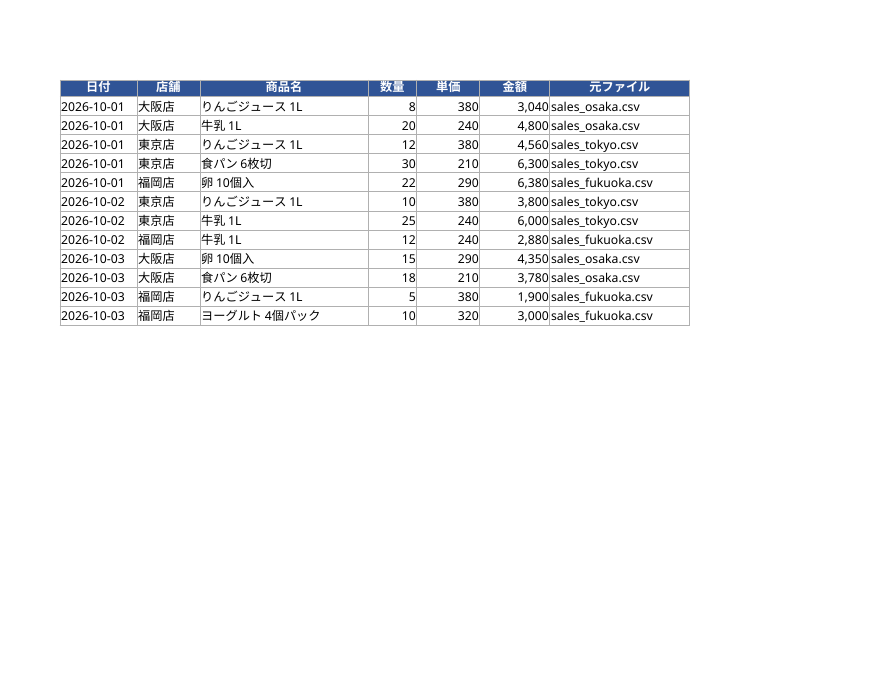

[日本語](README.md) | [English](README.en.md)

# CSV Normalizer & Reconciler

A sample tool for the classic back-office mess: CSV files from different
stores/systems where column names, column order, date formats and even
text encodings (Shift-JIS mixed in) all differ. It merges them into one
clean dataset and reconciles it against a second source (e.g. an
accounting ledger), reporting every difference.

## Input → Output

- **Input** (`sample_data/`, all fictional)
  - `sales_tokyo.csv` — UTF-8, Japanese headers, `2026/10/01` dates (contains 1 duplicate row)
  - `sales_osaka.csv` — **Shift-JIS**, English headers, `2026-10-01` dates
  - `sales_fukuoka.csv` — UTF-8 with BOM, different headers/order, `Oct 1, 2026` / `2026年10月3日` dates
  - `ledger.csv` — the accounting ledger to reconcile against (with planted discrepancies)
- **Output** (`output/`)
  - `normalized_sales.csv` / `.xlsx` — merged, de-duplicated data
    (the workbook also has reconciliation / duplicates / data-quality sheets)
  - `reconciliation_report.md` — the reconciliation report



Result on the samples: 10 matched / 1 amount mismatch / 1 missing in ledger /
1 missing in store data / 1 duplicate removed / 1 data-quality warning
(quantity × unit price ≠ stated amount).

## Usage

```bash
pip install -r requirements.txt
python3 make_sample_data.py sample_data        # regenerate samples (optional)
python3 normalize_csv.py sample_data sample_data/ledger.csv
```

Header mapping lives in `column_map.json` — supporting a new CSV layout
means adding mapping lines, not changing code.

## Example client work this maps to

- Monthly consolidation of sales CSVs from multiple stores or EC platforms
- Reconciling system exports against Excel ledgers and listing the differences
- Unifying order/inventory feeds that arrive in a different layout per partner
- Automating recurring "same cleanup every month" work, incl. monthly reports

## Technical notes

- Python standard library (csv / json) + openpyxl; encoding auto-detection
  (UTF-8 / UTF-8 BOM / Shift-JIS / CP932)
- Date formats: `2026-10-01`, `2026/10/01`, `2026年10月1日`, `Oct 1, 2026`
- Reconciliation aggregates by (date × store × product) and classifies
  amount mismatches, quantity mismatches, and rows present on one side only
- Exact duplicates are removed and reported; rows where
  quantity × unit price ≠ amount are flagged as data-quality warnings

## About the sample data

All store names, products and amounts are fictional sample data.
