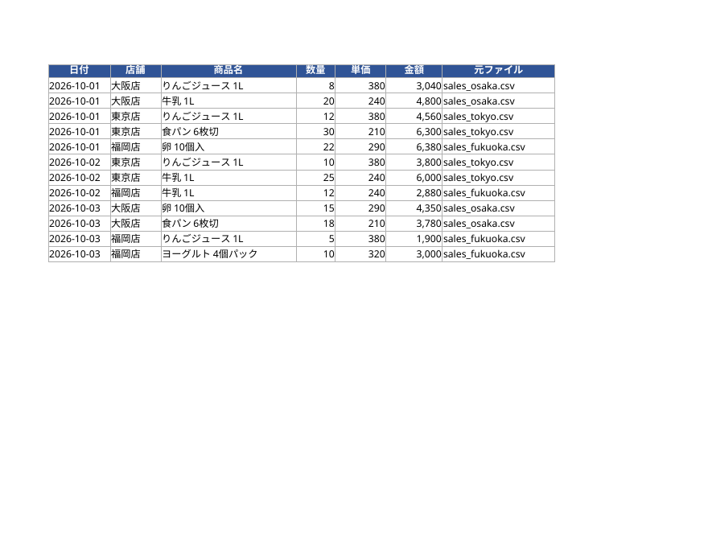

[日本語](README.md) | [English](README.en.md)

# CSV 統合・突合ツール

店舗や拠点ごとにバラバラなCSV——列名が違う、列の順番が違う、日付の書き方が違う、
文字コードが Shift-JIS 混じり——を、1つの統一フォーマットに統合し、
経理台帳などの別データと突合して差異をレポートするサンプルです。

## 入力 → 出力

- **入力**（`sample_data/`、すべて架空データ）
  - `sales_tokyo.csv` — UTF-8、日本語列名、日付は `2026/10/01` 形式（重複行を1件含む）
  - `sales_osaka.csv` — **Shift-JIS**、英語列名、日付は `2026-10-01` 形式
  - `sales_fukuoka.csv` — UTF-8 BOM、列名・列順が別、日付は `Oct 1, 2026`／`2026年10月3日` 形式
  - `ledger.csv` — 突合先の経理台帳（意図的に差異を仕込んであります）
- **出力**（`output/`）
  - `normalized_sales.csv` / `.xlsx` — 統合・重複除去済みのデータ（突合結果・重複・データ品質シート付き）
  - `reconciliation_report.md` — 突合レポート



サンプルの突合結果：一致10件／金額不一致1件／台帳に無い1件／店舗データに無い1件／重複除去1件／品質警告1件（数量×単価≠金額）。

## 使い方

```bash
pip install -r requirements.txt
python3 make_sample_data.py sample_data        # サンプル再生成（任意）
python3 normalize_csv.py sample_data sample_data/ledger.csv
```

列名の対応付けは `column_map.json` で管理しています。
新しいフォーマットのCSVが増えたら、マッピングに1行足すだけで取り込めます。

## 対応できる実務の例

- 複数店舗・複数ECモールの売上CSVを月次で1本化する作業
- 基幹システムの出力と Excel 台帳の突合（差異の洗い出し）
- フォーマットが取引先ごとに違う発注・在庫データの統一
- 「毎月同じ整形を手でやっている」定型作業の自動化と、月次レポート化

## 技術メモ

- Python 標準ライブラリ（csv / json）＋ openpyxl。文字コードは自動判定（UTF-8 / BOM付きUTF-8 / Shift-JIS / CP932）
- 日付は `2026-10-01`、`2026/10/01`、`2026年10月1日`、`Oct 1, 2026` 形式に対応
- 突合は（日付×店舗×商品名）単位で集計して比較。金額不一致・数量不一致・片側のみ存在を分類
- 重複行は除去してレポートに明記。数量×単価≠金額 の行はデータ品質警告として別枠で報告

## サンプルデータについて

店舗名・商品名・金額はすべて架空のサンプルデータです。
